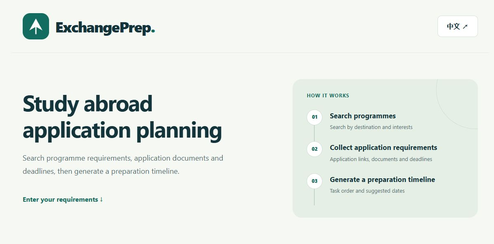
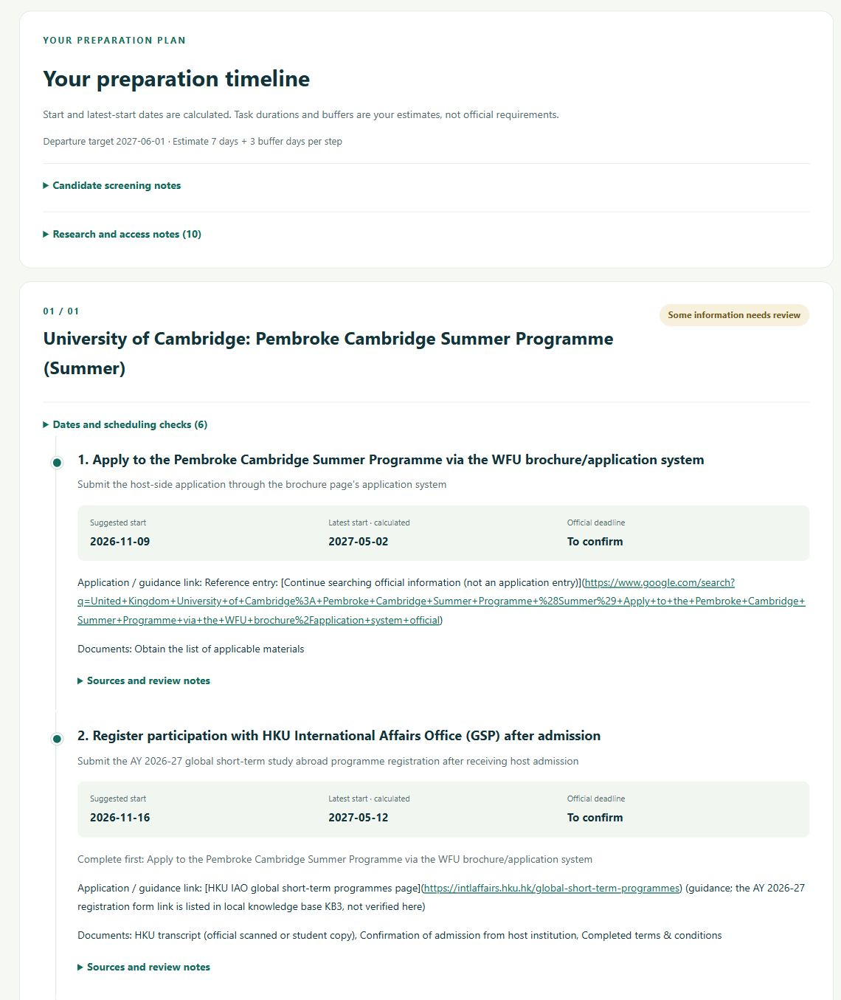
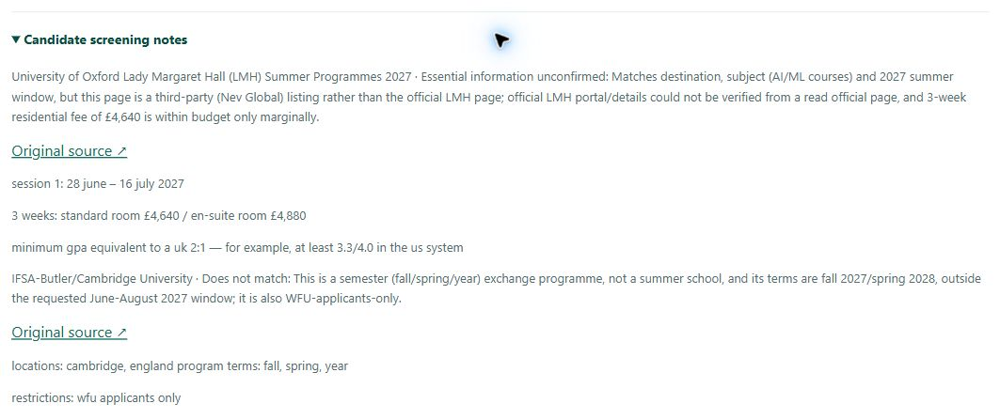
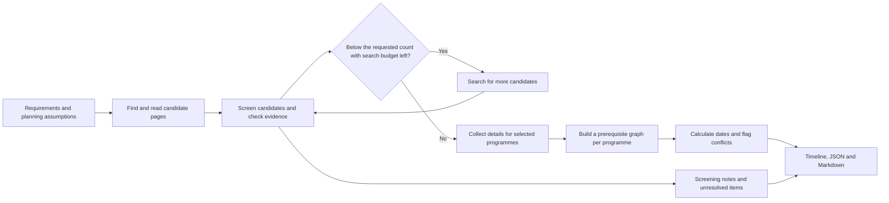

# ExchangePrep

[简体中文](README.zh.md) · [Online demo](https://gwdsd1.github.io/ExchangePrep/) · [Direct app](https://exchangeprep-gwdsd1.onrender.com/workspace)

ExchangePrep is an HKU COMP1110 group project for students planning summer school, winter school or semester exchange. It finds candidate programmes, checks application information against source pages and turns the selected programmes into preparation timelines.



## What the app does

- Searches by destination, programme type, preferred dates and optional details such as field of study and budget.
- Screens several candidates before collecting detailed requirements. If there are fewer matches than requested, it runs up to two additional search rounds and explains the shortfall. Candidates with essential information still to verify appear separately from the timelines.
- Collects application links, documents, deadlines and prerequisites. The timeline shows suggested starts, calculated latest starts and official deadlines in separate columns.
- Provides Chinese and English interfaces, expandable source and review notes, and downloadable JSON and Markdown.

## Run it

**Online.** Open the [online demo](https://gwdsd1.github.io/ExchangePrep/) and select **Try an offline example** to view a built-in short-term study plan without a key. For live research, choose DeepSeek or OpenAI, enter your own API key, fill in the requirements and planning assumptions, then select **Research and build my timeline**. Live calls are billed by the provider.

**Local on Windows.** Install Python 3.11 or later and double-click `start.cmd`. The launcher prepares a virtual environment, starts the local service and opens the workspace in your browser. Keep the terminal open while using the app.

**Manual start.** Run these commands from the repository root.

```sh
python -m venv .venv
.venv/bin/python -m pip install -r requirements.txt
.venv/bin/python -m uvicorn app:app --host 127.0.0.1 --port 8000
```

On Windows, use `.venv\Scripts\python.exe` for the last two commands. Open [the local workspace](http://127.0.0.1:8000/workspace). The standalone [planner viewer](http://127.0.0.1:8000/planner) loads the built-in planning cases.

## Worked examples

### Live research · UK summer school

This result was captured from the open ExchangePrep session in Edge on **9 November 2026**. The request specified the UK, summer school, **1 June–31 August 2027**, and up to **one programme**. The planning assumptions were departure on **1 June 2027**, with **seven days** per step and a **three-day buffer**.

The result proposed a plan for the **Pembroke Cambridge Summer Programme** and flagged it for review. The screenshot shows the host application task followed by HKU IAO registration after admission. The host application link still needed verification and the official deadline remained **To confirm**.



The screening panel records why two alternatives did not receive timelines. The result marked **Lady Margaret Hall** as unconfirmed because it could not verify the official details in that run. It excluded a **Cambridge semester exchange listing** because the programme type and dates fell outside the request. These screenshots are a dated record of the application's output. Use the institutions' current information to make application decisions.



### Offline planner · HKUWW semester exchange

These fixtures can be replayed without web research. The two HKUWW cases show how the planner handles language score validity, and the reference letter fixture shows its cycle check.

| Case | What to inspect | Saved result |
| --- | --- | --- |
| HKUWW main round, 2027/28 Semester 1 | The IELTS score expires before departure, so the timeline flags one blocking conflict. | [Timeline](output/timeline_main_case.md) · [JSON](output/timeline_main_case.json) |
| HKUWW with a valid score at departure | The language score conflict clears. The saved plan remains marked at risk. | [Timeline](output/timeline_valid_score.md) |
| Circular reference letter prerequisites | The planner reports a cycle among prerequisite tasks. | [Conflict report](output/timeline_cycle_example.md) |

```sh
python -m planner.cli plan --case planner/cases/hkuww_main_round_2027.json
```

Run the command with the project virtual environment active. For the other fixtures, see [planner/cases](planner/cases/) and the [planner guide](PLANNER_GUIDE.md).

## How it works



The planner uses prerequisite order, a backward pass from applicable deadlines and date anchors, and validity checks such as score expiry. AHP provides task priority scores. Suggested dates and buffers reflect the planning assumptions. Unverified deadlines stay open for review. [Planner design](PLANNER_GUIDE.md)

## Code layout

| Path | Responsibility |
| --- | --- |
| [app.py](app.py) · [workflow.py](workflow.py) | FastAPI routes, request-scoped keys, research jobs and the handoff to planning |
| [research.py](research.py) · [deepseek_web.py](deepseek_web.py) | Candidate search, page reading, evidence checks and bounded supplementary search |
| [models.py](models.py) · [knowledge_base.py](knowledge_base.py) | Request and result schemas, plus retrieval from the editable HKU knowledge base |
| [planner/](planner/) | Prerequisite graph, scheduling, conflict checks, AHP and exports |
| [static/](static/) · [docs/](docs/) | Workspace source, GitHub Pages build and documentation images |
| [tests/](tests/) · [output/](output/) | Regression tests and saved planning results |

The backend uses Python and FastAPI, and the frontend uses HTML, CSS and JavaScript. GitHub Pages serves the public frontend and Render runs the API. The web app offers DeepSeek Search/Fetch or OpenAI web search. Developer configuration also supports Brave, browser search and a supplied-URL mode. [Deployment and configuration](DEPLOYMENT.md)

## Inputs and outputs

A minimal live workflow request looks like this. The browser sends the API key separately in the `X-API-Key` header.

```json
{
  "provider": "deepseek",
  "language": "en",
  "destination": "United Kingdom",
  "programme_type": "summer_school",
  "start_date": "2027-06-01",
  "end_date": "2027-08-31",
  "departure_date": "2027-06-01",
  "max_programmes": 1,
  "duration_days": 7,
  "buffer_days": 3
}
```

The web app submits to `POST /api/workflow/jobs` and polls `GET /api/workflow/jobs/{job_id}`. The synchronous `POST /api/workflow` is available for integrations. The exported JSON contains `research` (programme details, sources, search records and screening notes), `plans` (steps, dates and conflicts per programme), `assumptions` and `markdown`. [Offline JSON example](docs/static/sample-workflow-en.json)

## Development notes

Run the suite from the repository root with `python -m unittest discover -s tests -v` in the project virtual environment. The repository includes tests for search and screening, evidence validation, scheduling and browser interactions.

[Usage guide](DEMO_GUIDE.md) · [Planner guide](PLANNER_GUIDE.md) · [UI design](UI_DESIGN.md) · [Deployment](DEPLOYMENT.md) · [Maintainer handoff](MAINTAINER_GUIDE.md)

Research and extraction by Wang Zhengwei. Timeline planning by Gao Huaze. [Original planner repository](https://github.com/Kura-cybc/COMP1110)
