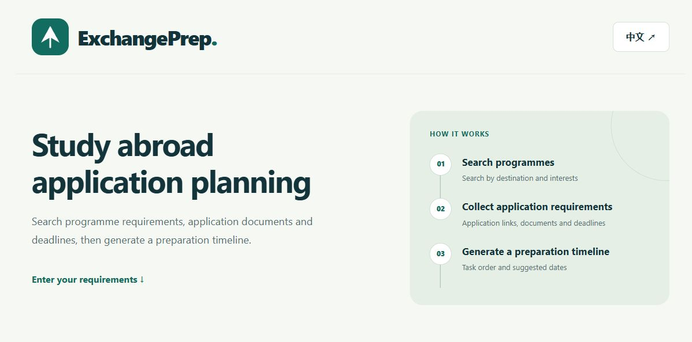
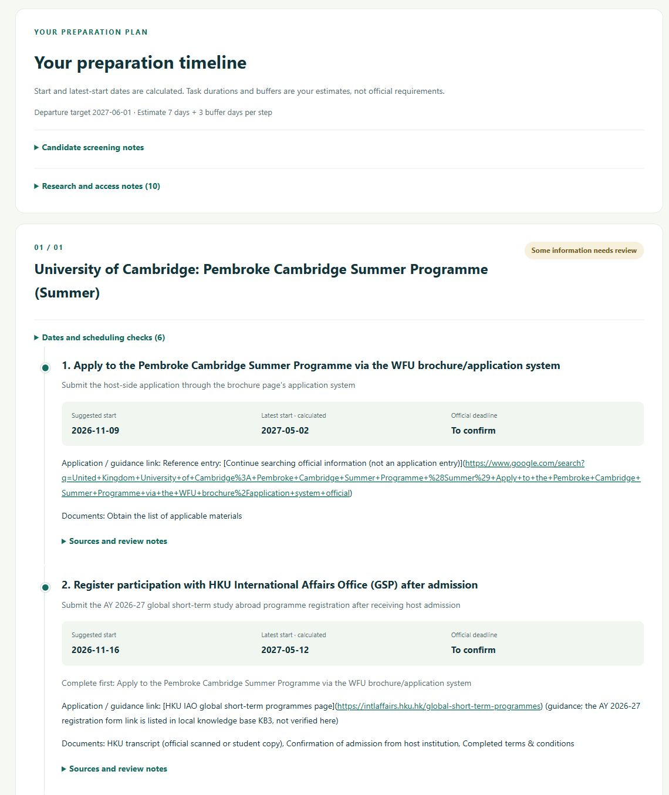
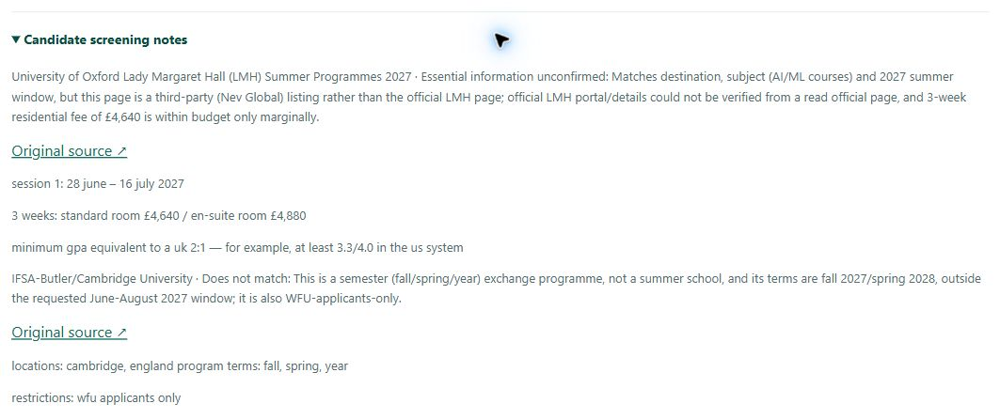
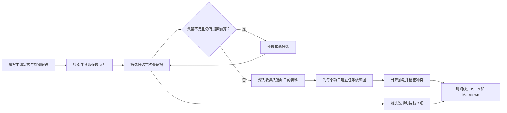

# ExchangePrep

[English](README.md) · [在线体验](https://gwdsd1.github.io/ExchangePrep/) · [独立站点](https://exchangeprep-gwdsd1.onrender.com/workspace)

ExchangePrep 是 HKU COMP1110 小组项目，面向准备申请暑校、寒校或学期交换的学生。它按需求寻找项目，核查申请资料，并把选中的项目整理成带有任务顺序和日期的准备时间线。



## 功能

- 根据目的地、项目类型、日期和选填的专业、预算等条件检索项目。
- 先筛选多个候选，再深入收集申请要求。结果少于设定数量时，最多补搜两轮，并说明不足原因。关键信息未确认的候选单列在筛选说明中。
- 整理申请入口、材料、截止日期和前置任务。时间线分别显示建议开始、计算所得的最晚开始和官方截止。
- 支持中英文界面、展开查看来源与核查说明，以及下载 JSON 和 Markdown。

## 运行方式

**在线体验。** 打开[在线项目页](https://gwdsd1.github.io/ExchangePrep/)，选择「先体验离线示例」，即可查看内置短期学习计划。实时查询时，选择 DeepSeek 或 OpenAI，填写个人 API Key、申请需求和排期假设，再点击「搜索并生成时间线」。实时调用由提供商按账户计费。

**Windows 本地运行。** 安装 Python 3.11 或更新版本后，双击 `start.cmd`。启动器会准备虚拟环境、运行服务，并在浏览器打开工作区。使用期间保留终端窗口。

**手动启动。** 在仓库根目录运行以下命令。

```powershell
python -m venv .venv
.\.venv\Scripts\python.exe -m pip install -r requirements.txt
.\.venv\Scripts\python.exe -m uvicorn app:app --host 127.0.0.1 --port 8000
```

macOS 和 Linux 的虚拟环境解释器位于 `.venv/bin/python`。启动后打开[本地工作区](http://127.0.0.1:8000/workspace)，或通过[规划器案例页](http://127.0.0.1:8000/planner)查看内置案例。

## 案例

### 实时查询 · 英国暑校

截图取自 **2026 年 11 月 9 日** Edge 中打开的 ExchangePrep 实例。查询条件是英国暑校、**2027 年 6 月 1 日至 8 月 31 日**，最多 **1 个项目**。排期假设为 **2027 年 6 月 1 日出发**，每步估算 **7 天**，另加 **3 天**缓冲。

该次查询为 **Pembroke Cambridge Summer Programme** 生成了带核查提示的时间线。图中第一步是核查并办理主办方申请，第二步是获录取后向 HKU IAO 登记。主办方申请入口仍需核实，官方截止栏显示「待确认」。



展开筛选说明可以看到另外两个候选的处理原因。该次结果将 **Lady Margaret Hall** 标为关键信息未确认，因为本轮未能核实其官方项目资料。另一条 **剑桥学期交换** 线索的项目类型和日期与查询条件不符，因此被排除。截图记录当次查询输出，实际申请请核对院校当前资料。



### 离线规划 · HKUWW 学期交换

以下内置案例可以离线复现。前两例对照语言成绩有效期的影响，第三例演示前置任务环路检查。

| 案例 | 可观察到的结果 | 已生成文件 |
| --- | --- | --- |
| HKUWW 2027/28 第一学期主轮 | 雅思成绩在出发前过期，规划器报告一条阻塞冲突。 | [时间线](output/timeline_main_case.md) · [JSON](output/timeline_main_case.json) |
| HKUWW 成绩有效对照 | 语言成绩冲突消失，保存的计划仍标记为有风险。 | [时间线](output/timeline_valid_score.md) |
| 推荐信前置条件成环 | 规划器报告前置任务之间存在循环。 | [冲突报告](output/timeline_cycle_example.md) |

激活项目虚拟环境后，可运行以下命令复现主轮案例。其他输入见 [planner/cases](planner/cases/) 和[规划器指南](PLANNER_GUIDE.md)。

```sh
python -m planner.cli plan --case planner/cases/hkuww_main_round_2027.json
```

## 系统流程



规划器依据前置关系安排任务，从适用的截止日期和时间锚点倒推，并检查成绩有效期等冲突。AHP 提供任务优先级分数。建议日期依赖用户填写的排期假设，尚未核实的截止日期继续标为待确认。[规划器设计](PLANNER_GUIDE.md)

## 代码结构

| 路径 | 职责 |
| --- | --- |
| [app.py](app.py) · [workflow.py](workflow.py) | FastAPI 接口、单次请求的密钥、调查任务及排期衔接 |
| [research.py](research.py) · [deepseek_web.py](deepseek_web.py) | 候选检索、页面读取、证据检查和有限补搜 |
| [models.py](models.py) · [knowledge_base.py](knowledge_base.py) | 请求和结果的数据结构、可编辑 HKU 知识库的检索 |
| [planner/](planner/) | 依赖图、排期、冲突检查、AHP 与导出 |
| [static/](static/) · [docs/](docs/) | 工作区前端、GitHub Pages 文件及文档图片 |
| [tests/](tests/) · [output/](output/) | 回归测试和已生成的规划案例 |

后端使用 Python 与 FastAPI，前端使用 HTML、CSS 和 JavaScript。GitHub Pages 托管公开前端，Render 运行 API。网页支持 DeepSeek Search/Fetch 与 OpenAI 网页搜索，开发配置还可使用 Brave、浏览器搜索和指定网址模式。[部署与配置](DEPLOYMENT.md)

## 输入与输出

以下为实时调查的请求示例。浏览器通过 `X-API-Key` 请求头单独发送密钥。

```json
{
  "provider": "deepseek",
  "language": "zh",
  "destination": "United Kingdom",
  "programme_type": "summer_school",
  "start_date": "2027-06-01",
  "end_date": "2027-08-31",
  "departure_date": "2027-06-01",
  "max_programmes": 1,
  "duration_days": 7,
  "buffer_days": 3
}
```

网页通过 `POST /api/workflow/jobs` 提交任务，再轮询 `GET /api/workflow/jobs/{job_id}`。同步接口为 `POST /api/workflow`。导出的 JSON 包含 `research`（项目、来源、搜索记录及筛选说明）、`plans`（逐项目的任务、日期与冲突）、`assumptions` 和 `markdown`。[离线 JSON 示例](docs/static/sample-workflow-zh.json)

## 开发与文档

激活项目虚拟环境后，在仓库根目录运行 `python -m unittest discover -s tests -v`。现有测试覆盖搜索与筛选、证据检查、排期及浏览器交互。

[使用指南](DEMO_GUIDE.md) · [规划器指南](PLANNER_GUIDE.md) · [界面设计](UI_DESIGN.md) · [部署说明](DEPLOYMENT.md) · [历史交接文档](MAINTAINER_GUIDE.md)

信息调查与提取由 Wang Zhengwei 完成，时间线规划由 Gao Huaze 完成。[原规划模块仓库](https://github.com/Kura-cybc/COMP1110)
